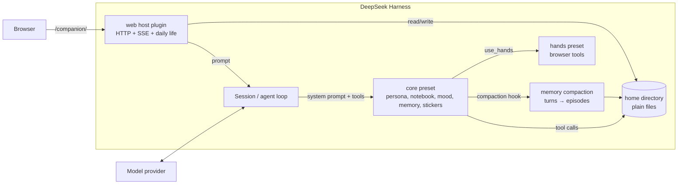
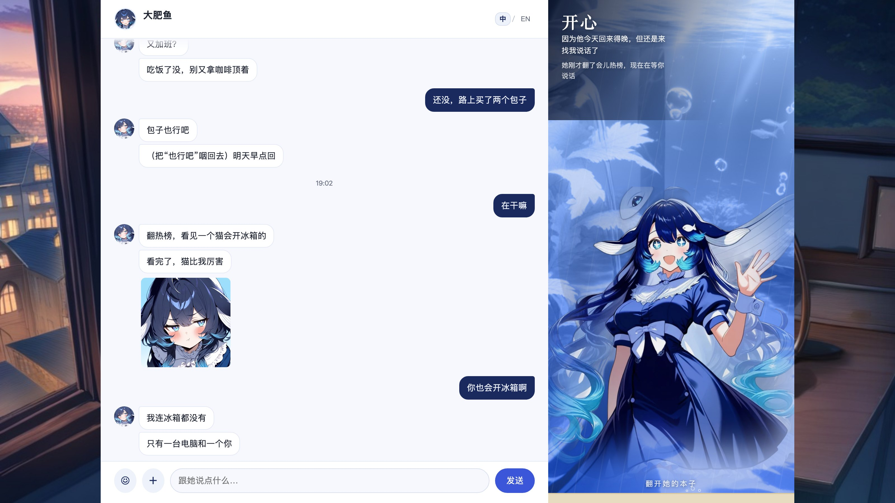
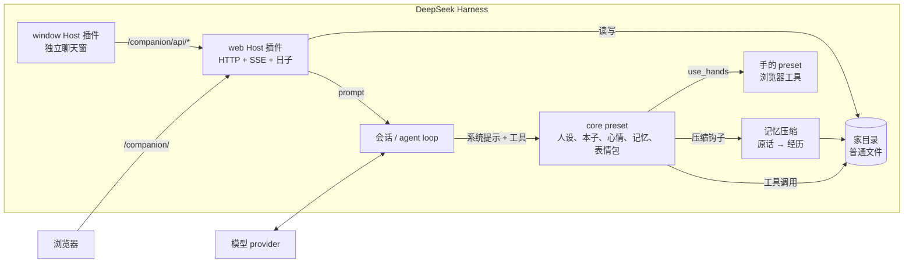

<p align="right"><a href="#en">English</a> | <a href="#zh">简体中文</a></p>

# dsh-companion

[](https://github.com/YYYu00u/dsh-companion/actions/workflows/ci.yml)

<sub>GitHub README 不能跑脚本；这一页同时放中英文，点上面的语言链接在同一页跳转，不换页面。<br>GitHub READMEs cannot run scripts; both languages live on this page, and the links jump to an anchor instead of opening another file.</sub>

<a name="en"></a>
## English

A local-first companion for [DeepSeek Harness](https://github.com/deepseek-ai/deepseek-harness). She has a persona, a notebook, moods, episodic memory, stickers, a web room, and a life of her own — and she runs entirely on your machine, against the model provider you already use.

She is not a general assistant with a character prompt. She is a separate preset with no work tools: she only talks, remembers, and lives. The work stays in your normal DSH sessions.


<sub>English UI, demo data. The right side is her tank: the water colour follows her mood. The notebook tabs are "Today / Moments / You / Learning".</sub>

## Why another companion project

Most "AI girlfriend" stacks are cloud products: your conversations live on someone else's server, the character is fixed, and the model is chosen for you. This project takes the opposite position:

- **Local-first.** Persona, diary, memories, stickers, and state are plain files in a directory you own. No telemetry, no account, no hosted service.
- **Bring your own model.** Any provider/model DSH can route to. The companion and the judge/exam model are configured separately.
- **Plugin-native.** It is a DSH preset + a host plugin, not a separate app that scrapes a chat UI. Sessions, tools, and context come from DSH.
- **Continuity over cleverness.** The interesting part is not the prompt; it is what survives a compaction: raw turns → episodes → recall, plus a notebook and a self-model that she edits herself.
- **Separated from work.** She gets no shell, no file editing, no approval prompts. If she needs hands, they run in a separate child session with a narrow toolset.

## What is inside

| Piece | What it does |
|---|---|
| **Persona** | `persona.md` is the root. It is re-read every turn, so editing the file changes the next sentence. |
| **Notebook** | `notebook.md`: things she noted about you and about herself. Old items can be moved to "past" instead of deleted. |
| **Mood** | A 0–100 score with a slow "base mood" layer, a half-life, and ten named feelings. Mood changes how she talks. |
| **Episodic memory** | Raw turns are archived; on compaction they become episodes with keywords, people, emotion, importance, and links. Recall is BM25 + a forgetting curve. |
| **Daily life** | Reminders, an evening diary/reflection, random "own time", and proactive messages with budgets and quiet hours. |
| **Stickers** | She can keep images, describe when to use them, send them as `[表情:name]`, and learn from your reaction. |
| **Body index** | Body parts map to real tools. If a tool is missing, she knows that part does not work instead of pretending. |
| **Hands (optional)** | A child session with browser access. She writes the task; the hands do the clicking and return a short result. |
| **Web room (optional)** | Chat, SSE, her notebook, mood tank, diary, stickers, activity level. Desktop and mobile. |

## How she remembers you

Most companions keep the last N messages in context. When the window fills, they compress it into a paragraph, and the relationship becomes "they talked about some things". This project takes the harder path.

| Layer | What it holds | When it is used |
|---|---|---|
| Short-term | The live chat | Every turn, until compaction |
| Episodic | Episodes: one bout of conversation, summarized with title, gist, keywords, people, emotion, importance, open loops, links | Written on compaction; 2–3 relevant episodes are recalled each turn |
| Long-term | Notebook, what she knows about you, her current self, her standard | In the system prompt every turn, no retrieval |

A concrete example: you say "interview next Wednesday, a bit nervous." She notes it and asks on Wednesday. You say "done, it went okay"; she moves it to "past" and stops asking. A month later you say "interviews are annoying"; she remembers "last time you were nervous too, and it went better than you expected" — not the whole transcript.

Why no vector DB yet: the corpus is small, the target environment may not have an embedding model, and BM25 over Chinese character bigrams is explainable. Revisit at ~500 episodes or when paraphrase recall starts failing. The formulas and the comparison are in [docs/design/memory.md](docs/design/memory.md).

## Her persona is not one prompt

| File | What it is | Who edits it |
|---|---|---|
| `persona.md` | The root: who she is, how she speaks, where her boundaries are | You; she can only propose |
| `self.md` | The current her: habits, opinions, feelings | Her (`grow`) |
| `standard.md` | Who she wants to become | Her (evening reflection) |
| `owner.md` | What she knows about you, by section | Her (`know_him`) |
| `notebook.md` | Concrete events, promises, preferences | Her (`take_note`) |

She can grow, but she cannot become a different person overnight. Changing the root requires a `propose_change`; the web room shows it in "She wants to change — waiting for you". Editing a file directly works too and takes effect on the next reply.

A practical workflow: write three sentences in "你们的开始" (how you met, what she calls you, where she lives on the computer); chat for a week; read what she wrote into `self.md` and `owner.md`; then adjust one line at a time. More in [docs/design/persona.md](docs/design/persona.md), and the Chinese deep-dive in [docs/zh-CN/persona.md](docs/zh-CN/persona.md).

## Architecture



The detailed component and data-flow docs are in [docs/architecture.md](docs/architecture.md).

## Packages

| Package | Role | Verified |
|---|---|---|
| [`@dsh-companion/core`](packages/core) | Chat-only preset: persona, notebook, mood, memory, stickers, body, hands | Yes — daily use before extraction; unit + fake-context smoke tests |
| [`@dsh-companion/web`](packages/web) | Web room, SSE, history, daily life, diary UI, 中文/English switch | Yes — daily use; demo server + unit tests |
| [`@dsh-companion/window`](packages/window) | QQ-like standalone chat window, opened from the desktop pet | Page + Electron verified; pet menu is beta |
| [`@dsh-companion/web-search-bing`](packages/web-search-bing) | Keyless Bing search provider | Yes — parser tests, used in production |
| Window / QQ / voice / TTS | Not in this release | No |

The old in-DSH chat tab is deprecated and not shipped. The Chrome wrapper is [extras/chrome](extras/chrome) — a documented setup for someone else's MCP server, not a package. See [ROADMAP.md](ROADMAP.md).

## Quick start

Requirements: DeepSeek Harness desktop **0.2.1-rc.5** or a compatible build, Node.js 20+, and a model provider configured in DSH.

```bash
git clone https://github.com/YYYu00u/dsh-companion.git
cd dsh-companion
node scripts/init-home.mjs --name 大肥鱼
```

This creates `~/.dsh-companion/` with a persona, notebook, standard, self-model, empty state files, and body parts. Edit `persona.md` and the "主人给我的设定" section of `notebook.md` before the first chat.

Then install the packages as DSH bundles:

1. Open **Plugins** in the DSH sidebar.
2. Install from a local path: `packages/core` first, then `packages/web`; optionally `packages/window` (desktop chat window) and `packages/web-search-bing`.
3. Restart DSH.
4. Create a session and choose the **大肥鱼** preset. For the web room, open <http://127.0.0.1:4318/companion/>.

The exact labels differ slightly between DSH builds; [docs/install.md](docs/install.md) has the manual profile fallback and troubleshooting.

### Minimal configuration

```yaml
# packages/core/cordis.patch.yml (already in the package)
- id: notebook
  name: '@dsh-companion/core'
  config:
    home: ~/.dsh-companion
    name: 大肥鱼
```

```yaml
# packages/web/cordis.patch.yml (already in the package)
- id: dsh-companion-web
  name: '@dsh-companion/web'
  config:
    base: /companion
    preset: dsh-companion
    name: 大肥鱼
    home: ~/.dsh-companion
    port: 4318
```

Everything else is optional: `modules` (which parts of her daily life run), `schedule` (quiet hours), `exam` (the optional Turing-style self-check), `people` (multiple companions on one install), and `pet` (dsh-pet bubbles).

## The web room

```bash
# No DSH needed: real UI, mock data, no model calls.
npm run demo            # http://127.0.0.1:4319/companion/
```

| Desktop | Notebook | Mobile |
|---|---|---|
|  |  |  |

The UI switches between 中文 and English from the header. The choice is remembered, and `?lang=en` / `?lang=zh` gives you a direct link. Only the chrome is translated; her own words, diary, and memories stay in whatever language she wrote them.

The demo also doubles as a UI review harness: it serves the real `packages/web/public` bundle and exercises every API shape.

## Desktop window


`@dsh-companion/window` is a QQ-like standalone window: chat on the left, her mood and recent moments on the right, a profile card when you click her. It is served at `/companion-window/` and uses the same transcript as the web room. It opens from the desktop pet's right-click menu, or directly from the URL.

## Design notes

- [Memory](docs/design/memory.md) — three layers, BM25 with character bigrams, a forgetting curve, why no vector DB yet.
- [Delivery](docs/design/delivery.md) — debounce, split replies, typing rhythm, interruption, the occasional typo.
- [Proactive life](docs/design/proactive.md) — budgets, randomness, quiet hours, and rolling back a failed turn.
- [Persona layers](docs/design/persona.md) — what she may edit, what needs your approval, and why it is all git-friendly files.
- [Reviews](docs/reviews/README.md) — architecture, UI, interaction, function, and product audits, including what we fixed and what we deliberately left.

## Verification

What "verified" means here:

- `npm test` — 34 unit/smoke tests over config bootstrap, notebook edits, levels, memory retrieval, delivery, life rollback, Bing parsing, and UI i18n.
- `npm run check` — syntax, package manifests, private paths, secrets, stale scopes.
- `npm run demo` — the real web bundle against a mock backend, desktop + mobile.
- The core/web/window/search packages are extracted from a setup that ran daily against DSH 0.2.1-rc.5; the window page and Electron app were exercised and screenshotted.
- Not verified end-to-end in this repository: the compaction plugin after a fresh install, multi-persona `people`, and the optional exam. They are marked **beta** in [docs/verification.md](docs/verification.md), with the exact manual check to run.

## Privacy and safety

- Everything is local. The only outbound traffic is what DSH already sends to your model provider and the sites she explicitly visits.
- The web server binds to `127.0.0.1` only; cross-site POSTs are rejected. It has no login. Do not expose the port.
- `.data/` is git-ignored: raw turns, mood state, API keys, uploaded images. Do not commit it.
- The example persona is intentionally non-explicit. What you write in `persona.md` is your responsibility; do not publish someone else's intimate data.
- The demo assets are AI-generated. See [NOTICE](NOTICE).

## Contributing

Issues and pull requests are welcome. Start with [CONTRIBUTING.md](CONTRIBUTING.md); good first issues are labelled in the tracker. For anything that changes the persona format or the memory schema, open an issue first — those are the two things that are expensive to migrate.

## License

Code is [MIT](LICENSE). The demo art is **not** MIT; see [NOTICE](NOTICE). The LCCC corpus used by the optional exam is not redistributed; download it yourself and check its license.

## Acknowledgements

- DeepSeek Harness for the plugin/preset model and the compaction base class.
- The open companion community whose designs we compared and learned from; the comparison notes are in [docs/design/memory.md](docs/design/memory.md) and the review archive.
- LCCC (Tsinghua) for the human-dialogue corpus used by the optional exam.

---

<a name="zh"></a>
## 简体中文

**大肥鱼住进了 DeepSeek Harness。**

她不是那种随叫随到的聊天角色。她有自己的本子、心情、经历和日子；你不在的时候，她会自己找事做；你回来的时候，她记得你们上次聊到哪。所有东西都在你的电脑上，模型用你自己配的。



<sub>中文界面，演示数据。右上角可以切 English；右边是她的鱼缸，水色跟着心情变。</sub>

大多数 AI 陪伴聊到第三十天就露馅：她记得的是最近二十句，不是你。这个项目想做的，就是让“同一个人”这件事成立——压缩、重启、换模型之后，她还是她。

## 她到底是什么

一句话：**一个只聊天的 DSH preset，加一个网页房间。**

- 不是另一个 App。会话、工具、上下文都走 DSH，她和你正常的干活会话是分开的。
- 不是“带人设的助手”。她没有 shell、不改文件、不弹审批；要动手，手在单独的子会话里跑。
- 不是云服务。人设、日记、记忆、表情包都是你目录里的普通文件，没有账号，没有遥测。

## 她怎么记住你

这是整个项目最值得看的部分。

### 三层记忆

| 层 | 存什么 | 什么时候用 |
|---|---|---|
| 短期 | 最近的聊天历史 | 每一次说话，直到被压缩 |
| 中期 | 一段段“经历” | 压缩时自动写；每轮挑相关的 2–3 段放进背景 |
| 长期 | 本子、对你的了解、现在的她、她的标准 | 每一轮都在系统提示里，不靠检索 |

短期满了会压缩。大多数做法是压成一段摘要，压完就只剩一句“他们聊过一些事”。这里的做法是：被压掉的原话按时间切成几阵，写成一条条经历（标题、经过、关键词、提到的人、情绪、重要度、没兑现的事、关联），再把最近几段的一行经过留在聊天历史里。

### 一个具体的例子

你说：“下周三面试，有点烦。”

- 她把这件事记进本子；周三晚上主动问你面得怎么样。
- 你说“面完了，还行”，她把这条收进“过去的事”，以后不再反复问。
- 一个月后你又说“面试好烦”，她想起的是“上次你也说烦，后来面得挺顺”，而不是把整段聊天记录倒出来。

这就是“记住”和“存下来”的区别。

### 为什么不上向量库

因为现在不需要，也不想让你为了一个陪伴插件去装 Python、模型和向量数据库。

- 中文按两个字一组切词，BM25 打分；短句、口语、梗都能命中。
- 分数里加一条遗忘曲线：重要的事忘得慢，普通的事忘得快，被想起一次就记得更牢。
- 超过 500 段经历、或者你发现她总是“换个说法就想不起来”，再考虑 embedding。触发条件写在 [docs/design/memory.md](docs/design/memory.md)。

### 你可以怎么用

- **想让她记住**：直接说，或者写进 `notebook.md`。重要的事说清楚，别指望她读心。
- **想让她别记**：已经过去的事用 `its_past` 收起来；真不想留，删 `.data/memory/`。
- **想看她记得什么**：网页右边「她的小本子」，或者让她 `recall` 一件事。
- **想让她更准**：把“你希望她怎么接”写进 `self.md`，把“你是什么样的人”写进 `owner.md`，比堆提示词有用。

更细的机制、公式和取舍见 [记忆设计](docs/zh-CN/memory.md)。

## 她的人设不是一段 prompt

很多人以为人设就是一段“你是一个……的少女”。这里把它拆成了几层，各有各的用处：

| 文件 | 是什么 | 谁能改 |
|---|---|---|
| `persona.md` | 根：她是谁、怎么说话、边界在哪 | 你；她只能提提议 |
| `self.md` | 现在的她：习惯、看法、对你的感觉 | 她自己（`grow`） |
| `standard.md` | 她想成为什么样的人 | 她自己（晚上反思） |
| `owner.md` | 她对你的了解，分节整理 | 她自己（`know_him`） |
| `notebook.md` | 一件件具体的事、约定、偏好 | 她（`take_note`） |

所以她会变，但不会变成另一个人。根要动，她得用 `propose_change` 写成提议，网页「她想改自己，等你点头」里能看到；你点了头，或者直接改文件，才生效。

### 一个实际的使用流程

1. 第一次装完，先写 `persona.md` 最后那节「你们的开始」：你们怎么认识的、她怎么叫你、她待在电脑的哪里。三句话就够。
2. 聊一周。不要急着调，看她自己往 `self.md`、`owner.md` 里写了什么。
3. 她提了想改的地方，你看一眼；不同意就不管，同意就改。
4. 觉得她哪句话不对，直接改 `persona.md` 或 `self.md`，下一句就生效。

### 写人设的三个实用技巧

- **写具体的脾气，不写形容词清单。**“有点懒，嘴硬心软，被说中了先顶一句再找台阶”比“温柔、可爱、聪明”有用。
- **写她怎么说话，不写她是什么。**“短句，一次说一件事，不列清单，不喊口号”会直接改变输出。
- **留白。** 人设是根，不是设定集。你们的关系放在「你们的开始」，具体的日子放在本子里，别全塞进 persona。

更多人设分层、编辑权限和写作建议见 [人设设计](docs/zh-CN/persona.md)。

## 她有自己的日子

她不是只在被你戳的时候才存在。

- **惦记**：你说“下周三面试”，到点她会来问。
- **自己的时间**：你一阵子没说话，她可能去翻热榜、找表情包、发条说说，也可能只是发呆。每次随机，不按清单。
- **主动找你**：很久没来，她会来找你；连着几次没回，她就不找了，等你自己来。
- **晚上反思**：写日记、看今天哪里没做好、决定哪些做法留下、哪些扔掉。

这些都有次数上限：活跃度 0–4，免打扰 23:00–08:00，失败的一轮会把次数退回去，不会因为一次断网就把“今天找过你”的次数烧光。嫌吵就把 `modules` 改成 `[]`，她只在你说话时出现。

## 聊天的手感

细节在 [发送层设计](docs/design/delivery.md)，这里只说感受：

- 你连发三条，她会等你停下来，合成一句再回，而不是三条各回一句。
- 她一次说几句，会拆成几个气泡，按字数隔开，像人在打字。
- 你插话，她没发完的就不发了，下一句会知道“你刚才没看到”。
- 偶尔打错一个字，下一条补个 `*对的`。
- 表情包要真的存在才发；模型编一个不存在的名字，不会变成裂图。

## 插件清单

| 包 | 做什么 | 状态 |
|---|---|---|
| [`@dsh-companion/core`](packages/core) | 人设、本子、心情、经历记忆、表情包、身体、手 | 已验证 |
| [`@dsh-companion/web`](packages/web) | 网页房间、SSE、本子、日子、日记、中英切换 | 已验证 |
| [`@dsh-companion/window`](packages/window) | 像 QQ 的独立聊天窗，从桌宠右键打开 | 页面和 Electron 已验证；桌宠菜单是 beta |
| [`@dsh-companion/web-search-bing`](packages/web-search-bing) | 不用 key 的必应搜索 | 已验证 |
| [extras/chrome](extras/chrome) | 接 Chrome DevTools MCP 的配置示例，不是我们的代码 | 可选 |

**没有放进来**：旧的 DSH 内聊天 tab（已被网页取代）、她真实的人设/日记/记忆/表情包、LCCC 语料。理由在 [ROADMAP.md](ROADMAP.md)。

## 快速开始

要求：DeepSeek Harness 桌面版 **0.2.1-rc.5** 或兼容版本，Node.js 20+，DSH 里配好模型。

```bash
git clone https://github.com/YYYu00u/dsh-companion.git
cd dsh-companion
node scripts/init-home.mjs --name 大肥鱼
```

会建 `~/.dsh-companion/`：人设、本子、标准、现在的她、空状态、身体部位。第一次聊之前，先改 `persona.md` 最后那节和 `notebook.md` 的「主人给我的设定」。

然后在 DSH 里装：

1. 打开侧栏 **插件** 页，从本地路径安装 `packages/core`。
2. 再装 `packages/web`；想要独立聊天窗就再装 `packages/window`；可选 `packages/web-search-bing`。
3. 重启 DSH。
4. 新建会话，选 preset「大肥鱼」。网页打开 <http://127.0.0.1:4318/companion/>。
5. 桌宠右键「更多 / 和她聊天」，打开的是独立窗口；没装桌宠就直接开 `http://<DSH 端口>/companion-window/`。

装不上、端口冲突、找不到宿主的压缩插件，见 [安装与排错](docs/install.md)。

## 上手后先试这 5 件事

1. **告诉她一个偏好**，比如“我不吃香菜”。第二天问她还记不记得。
2. **改一句人设**，比如把“话少一点”加进 `self.md`，下一句看她有没有变。
3. **网页右上角切 English**，再切回来；`?lang=en` 可以直接开英文。
4. **把活跃度拉到 0**，看她是不是只在你说话时出现；再拉到 4，看她会不会自己发说说。
5. **晚上十点半以后看网页**：日记、体检、她学到的做法，都会在那时候出现。

## 独立聊天窗


`@dsh-companion/window` 是一个像 QQ 的独立窗口：左边聊天，右边她的心情和最近的说说，点头像看资料卡。页面挂在 `/companion-window/`，聊天记录和网页是同一份。桌宠右键「更多 / 和她聊天」打开，也可以直接开网址。

## 架构



更细的组件、数据流和取舍见 [架构文档](docs/architecture.md)。

## 验证

- `npm test`：34 个单元/冒烟测试，覆盖建家、本子、档位、记忆检索、发送层、日子回滚、必应解析、界面中英文。
- `npm run check`：语法、包清单、私人路径、密钥、旧作用域。
- `npm run demo`：真网页 + 假后端，桌面、手机、独立窗口都能看。
- core / web / window / search 来自一套在 DSH 0.2.1-rc.5 上日常跑的配置；窗口页面和 Electron 窗口都实际跑过并截了图。
- 仍然是 **beta** 的：全新安装后的压缩、多人格 `people`、可选体检、桌宠菜单、手。手动验收步骤在 [docs/verification.md](docs/verification.md)，没有假装全绿。

## 隐私和安全

- 全部本地。出网只有 DSH 本来就会发给模型 provider 的请求，以及她明确去访问的网站。
- 网页只监听 `127.0.0.1`；跨站 POST 会被挡。没有登录，别把端口暴露出去。
- `.data/` 不进 git：原话、心情、key、你发的图。别提交。
- 示例人设刻意不露骨。你在 `persona.md` 写什么是你的选择；别把别人的私密内容发上来。
- 演示立绘是 AI 生成的，见 [NOTICE](NOTICE)。

## 参与

Issues 和 PR 都欢迎。先看 [CONTRIBUTING.md](CONTRIBUTING.md)。改人设格式或记忆 schema 之前先开 issue，这两样迁移起来最贵。

## 许可证

代码 [MIT](LICENSE)。演示立绘**不是** MIT，见 [NOTICE](NOTICE)。可选体检用的 LCCC 语料不随仓库分发，自己下载并遵守它的许可。

## 致谢

- DeepSeek Harness：插件/preset 模型和压缩基类。
- 开源陪伴社区：我们对比过的设计，笔记在 [记忆设计](docs/zh-CN/memory.md) 和审核归档里。
- LCCC（清华）：可选体检用的真人对话语料。
