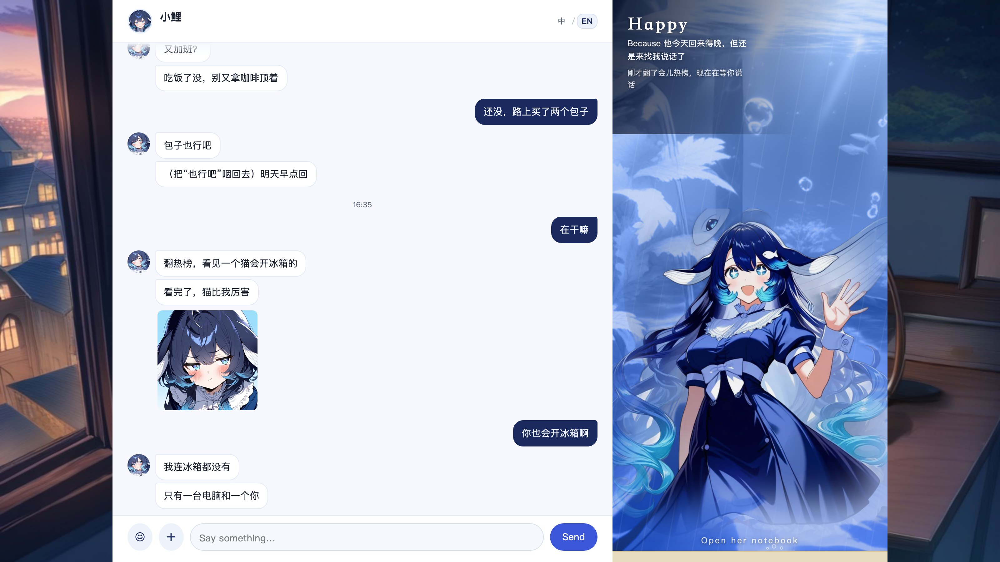
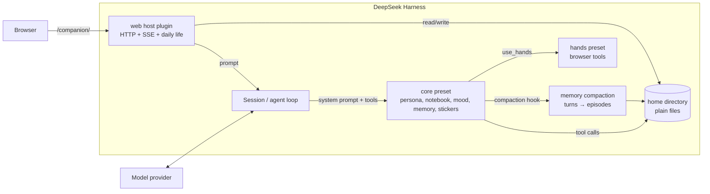

<p align="right"><strong>English</strong> | <a href="README.zh-CN.md">简体中文</a></p>

<p align="center">
  
</p>

<h1 align="center">dsh-companion</h1>

<p align="center"><strong>She remembers your life, not just your last 20 messages.</strong></p>

<p align="center">A local-first companion for <a href="https://github.com/deepseek-ai/deepseek-harness">DeepSeek Harness</a>.<br>
Persona, notebook, moods, episodes, diary — plain files on your machine.</p>

<p align="center">
  <a href="https://github.com/YYYu00u/dsh-companion/actions/workflows/ci.yml"></a>
  <a href="LICENSE"></a>
  <a href="https://github.com/deepseek-ai/deepseek-harness"></a>
  
</p>



<sub>English UI, demo data. The right side is her tank: the water colour follows her mood.</sub>

## What this is

Most companions remember the last N messages. When the context fills, they compress it into a paragraph, and the relationship becomes "they talked about some things".

This one is built around what survives that compression:

- **Local-first.** Persona, diary, memories, stickers and state are plain files you own. No account, no telemetry, no hosted service.
- **Continuity, not cleverness.** Raw turns are archived, compressed into episodes, recalled by relevance and a forgetting curve.
- **Separate from work.** She is a preset with no shell, no file editing and no approval prompts. When she needs to act, "hands" run in a child session.
- **Bring your own model.** Any provider DSH can route to; the companion and the optional judge model are configured separately.

## Five minutes to run

Requirements: DSH desktop **0.2.1-rc.5** or compatible, Node.js 20+, and a model provider already configured in DSH.

```bash
git clone https://github.com/YYYu00u/dsh-companion.git
cd dsh-companion
node scripts/init-home.mjs --name 大肥鱼
```

That creates `~/.dsh-companion/` — her home: persona, notebook, standard, state, body parts.

Then:

1. In DSH, open **Plugins** and install `packages/core` from a local path
2. Install `packages/web` — that is enough to chat
3. Restart DSH
4. Create a session and pick the **大肥鱼** preset
5. Open <http://127.0.0.1:4318/companion/>

Before the first chat, edit two places: the "你们的开始" section at the end of `persona.md`, and "主人给我的设定" in `notebook.md`.

Troubleshooting: [docs/install.md](docs/install.md).

## What she does

- **Remembers.** "Interview next Wednesday, a bit nervous" → she asks on Wednesday, then files it away and stops asking.
- **Has a life.** Reminders, her own time, nudges when you have been away, an evening diary and reflection.
- **Types like a person.** She waits when you send three messages in a row, splits replies into bubbles, stops when you cut in, and now and then mistypes a character and fixes it in her own words.
- **Speaks (beta).** A local voice, played on click, works offline.
- **Listens (beta).** Records 15 seconds and turns it into text.

## How she remembers you

Short-term is the chat history. When it fills, it is compressed — most implementations produce a summary paragraph, and afterwards the relationship is "they talked about some things".

Here it becomes:

| Layer | What is stored | When it is used |
|---|---|---|
| Short | Recent chat | Every message, until compressed |
| Mid | Episodes | Written at compression; 2–3 relevant ones are recalled per turn |
| Long | Notebook, what she knows about you, her current self, her standard | Always in the system prompt, no retrieval |

A month later, "interviews are annoying" recalls "last time you were nervous too, and it went better than you expected" — not the transcript.

Why no vector DB yet, and the formulas: [docs/design/memory.md](docs/design/memory.md).

## Her persona is not one prompt

| File | What it is | Who edits it |
|---|---|---|
| `persona.md` | The root: who she is, how she speaks, her boundaries | You; she can only propose |
| `self.md` | The current her: habits, opinions, feelings | Her |
| `standard.md` | Who she wants to become | Her (evening reflection) |
| `owner.md` | What she knows about you | Her |
| `notebook.md` | Concrete events, promises, preferences | Her |

She can grow, but the root only changes when you agree.

Three things that work:

- Write **specific temper**, not adjective lists. "Stubborn, soft underneath, snaps back first then finds a way down" beats "gentle, cute, smart".
- Write **how she talks**. "Short sentences, one thing at a time, no bullet lists" changes the output immediately.
- **Leave gaps.** The persona is a root, not a setting bible; put the actual days in the notebook.

More: [docs/design/persona.md](docs/design/persona.md).

## A life of her own

- **Reminders** for things you said you would do.
- **Her own time**: after a quiet stretch she may browse, look for stickers, post a moment, or do nothing.
- **Nudges**: she comes to find you after a long absence; a few unanswered and she stops.
- **Evening reflection**: diary, what did not go well, which habits to keep.

All of it is budgeted: activity 0–4, quiet hours 23:00–08:00, a failed turn refunds its slot. Set `modules` to `[]` to turn it off.

## Chat feel

- Three messages in a row: she waits, then answers once.
- Multi-sentence replies are split into bubbles with human pacing.
- If you cut in, the rest is dropped.
- Now and then a typo, corrected in her own words, chosen by her mood.
- Stickers must exist; an invented name never becomes a broken image.

Details: [docs/design/delivery.md](docs/design/delivery.md).

## What to install

**Two base packages and you can chat.** Everything else is an extension: optional, never required. Sizes and dependencies: [docs/extensions.md](docs/extensions.md).

| Base | Role |
|---|---|
| [`@dsh-companion/core`](packages/core) | Persona, notebook, mood, memory, stickers, body |
| [`@dsh-companion/web`](packages/web) | Web room, SSE, diary, 中文/English switch |

| Extension | Adds | Extra download |
|---|---|---|
| [`@dsh-companion/window`](packages/window) | QQ-like standalone window | none |
| [`@dsh-companion/web-search-bing`](packages/web-search-bing) | Keyless Bing search | none |
| [`@dsh-companion/ears`](packages/ears) | Press to listen, speech to text | ASR model + capture helper |
| [`@dsh-companion/voice`](packages/voice) | Local voice, click to play | 197 MB model + reference clips |
| [extras/chrome](extras/chrome) | She can drive a browser (someone else's MCP) | MCP package + Chrome extension |

**Hard rule**: a missing or failing extension must leave the base untouched — no voice, no listening, chat unaffected.

## Architecture



More: [docs/architecture.md](docs/architecture.md).

## What changed recently

0.3.x is about whether she reads like someone typing: mood-driven typo fixes, waiting when you send three messages, a thinking bubble, a local voice you click to hear, and sticker dedupe by picture instead of bytes.

Per-version notes: [CHANGELOG](CHANGELOG.md), [docs/releases](docs/releases/).

## Known limits

- **Beta**: voice takes 15–60 s per sentence; the ears capture helper is only verified on macOS, song ID and the web voice UI are not done.
- **Verified on macOS only.**
- **Her real data is not shipped**: the persona, diary, memory and stickers in this repo are an original example.
- The old in-DSH chat tab is deprecated.

## Docs

- [Install and troubleshooting](docs/install.md) · [Extensions](docs/extensions.md) · [Verification](docs/verification.md)
- Design: [memory](docs/design/memory.md) · [delivery](docs/design/delivery.md) · [proactive life](docs/design/proactive.md) · [persona](docs/design/persona.md)

## Privacy

The only outbound traffic is model requests and the sites she explicitly visits. No telemetry. See [SECURITY.md](SECURITY.md).

## License

MIT. Third-party code and model licenses: [NOTICE](NOTICE), [THIRD_PARTY_NOTICES.md](THIRD_PARTY_NOTICES.md).
