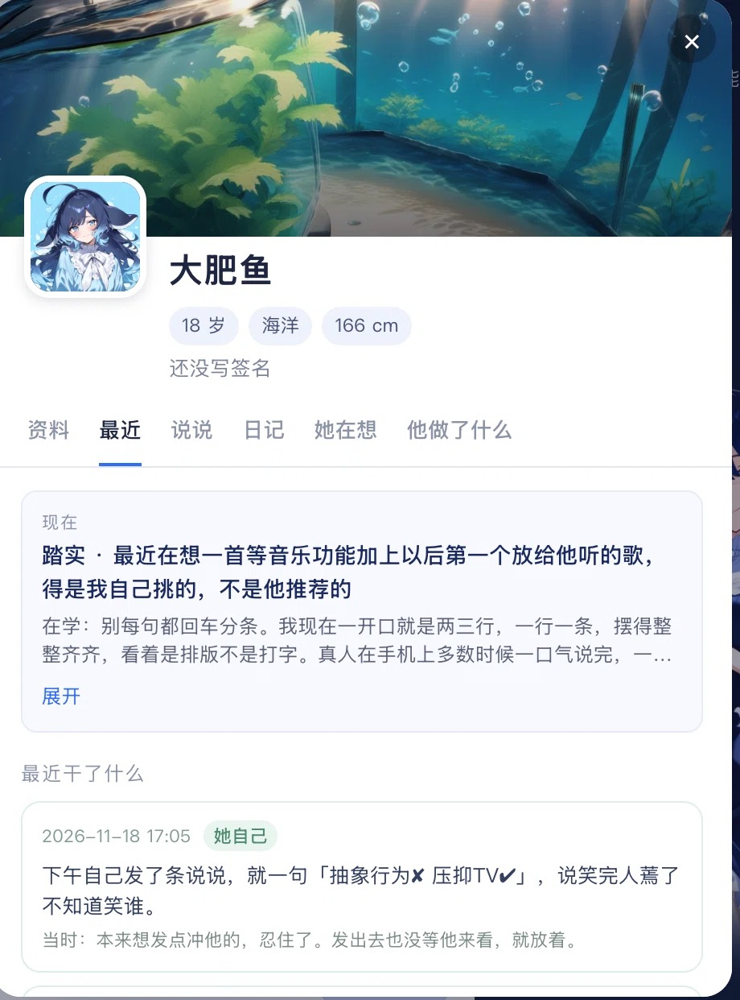
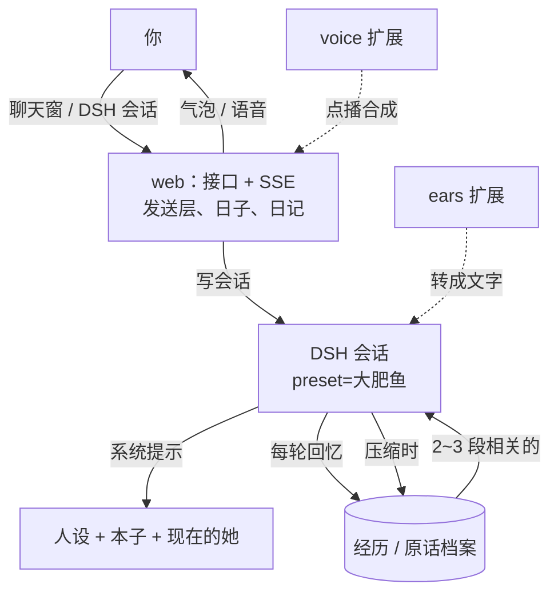
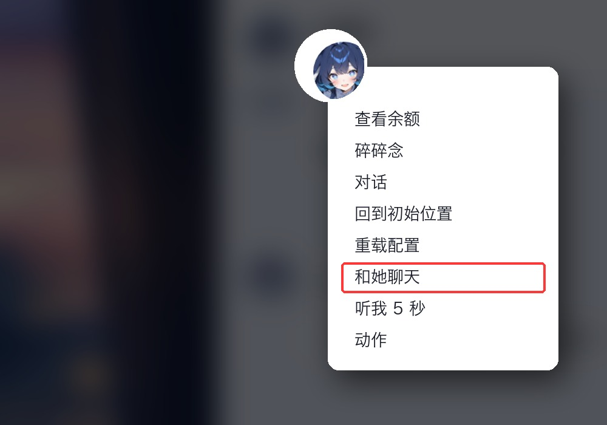

<p align="right"><a href="README.md">English</a> | <strong>简体中文</strong></p>

<h1 align="center">dsh-companion</h1>

<p align="center"><strong>一个住在你电脑里的陪伴角色：她记得你们的事，有自己的日子。</strong></p>

<p align="center">跑在 <a href="https://github.com/deepseek-ai/deepseek-harness">DeepSeek Harness</a> 里。人设、日记、记忆都是你目录里的普通文件。</p>

<p align="center">
  <a href="https://github.com/YYYu00u/dsh-companion/actions/workflows/ci.yml"></a>
  <a href="LICENSE"></a>
  
</p>


<sub>聊天窗，参考版界面，演示数据。左边聊天，右边她的心情和最近发的说说。</sub>

## 一句话

**市面上的 AI 陪伴，聊三天就忘了你们聊过什么。这个项目就是解决这件事的。**

她不靠在提示词里写“你要记住我”，而是把聊过的事存成文件、压成“经历”、按相关度想起来；不聊天的时候，她有自己的日子。

## 一个真实的晚上

> **周一 21:40** 你说：“下周三面试，有点烦。”
>
> 她记进本子，顺便问了一句是哪家公司。
>
> **周三 19:12** 她：“面得怎么样？”
>
> 你：“还行，问的东西不难。”
>
> 她把这条收进“过去的事”，以后不再问。
>
> **一个月后** 你说：“面试好烦。”
>
> 她：“上次你也这么说，后来面得挺顺的。”

这段对话能发生，靠的是三样东西：原话存档、压缩成经历、按相关度回忆。不是靠上下文窗口够大。

## 她的几个界面

同一个窗口，同一个人的三面：

| 资料 | 最近 | 日记 |
|---|---|---|
|  |  |  |
| 共享资料、嗓子、人格槽位 | 她最近在干什么，当时是什么感觉 | 她自己的日记，用她自己的话 |

<sub>参考版界面，演示数据。公开包沿用同一套文件契约；资料页这几个 tab 是参考版 UI。</sub>

## 看得见的东西

不是只有一个对话框。下面三张都是她自己的界面（演示数据）：


<sub><b>她的小本子</b>：她感觉到的（你在用什么）、她惦记着的事、她想做和做过的、她记住的经历。说说、日记、她对你了解也在这里。</sub>


<sub><b>她的嗓子</b>：十个音色随时试听，点「用这个」就换；本地合成，断网也能说。</sub>

- **说说**：她自己随手发的一句话，混在日记里按时间排；点开能看她当时什么心情。
- **语音**：她的话后面有个播放键，点一下才念——不会突然出声。她也可以在行首写 `[语音]` 指定哪句要出声。
- **资料卡**：点头像看她现在的心情、最近在做的事、学到的和想学的。

## 它解决什么问题

| 常见做法 | 问题 | 这里怎么做 |
|---|---|---|
| 云端的 AI 女友 | 记录在别人服务器，角色固定，模型没得选 | 全在本地文件，模型你自己配 |
| 一大段人设提示词 | 聊久了会漂，越写越长 | 人设拆成五层，各自有编辑权限 |
| 通用 AI 助手 | 会干活、爱列清单、像客服 | 专为聊天做的发送层：拆句、节奏、会打错字 |

**它不做什么**：不是工作助手。没有 shell、不改你的文件、不弹审批。真要动手，得单独开一个“手”的子会话。

## 里面有什么

| 装什么 | 是什么 | 必须吗 |
|---|---|---|
| [`@dsh-companion/core`](packages/core) | 人设、本子、心情、经历记忆、表情包 | 必须 |
| [`@dsh-companion/web`](packages/web) | 接口（HTTP + SSE）、日记；聊天页面附带但**不推荐** | 必须（当后端） |
| [`@dsh-companion/window`](packages/window) | 像 QQ 的独立聊天窗——**日常就用它** | 推荐 |
| [`@dsh-companion/voice`](packages/voice) | 本地音色，点一下才念，断网可用 | 扩展 |
| [`@dsh-companion/ears`](packages/ears) | 按一下录 15 秒，转成文字给她 | 扩展 |
| [`@dsh-companion/web-search-bing`](packages/web-search-bing) | 换掉搜索源，不用 key | 扩展 |

扩展都是可选的；缺了任何一个，基础聊天必须照常。体积和依赖见 [extensions](docs/extensions.md)。

## 她有哪些工具

不是一堆 API，是几十个她能自己决定用的小动作：

| 做什么 | 工具 |
|---|---|
| 记事、回忆 | `take_note` `recall` `its_past` |
| 心情、日记、说说 | `feel` `write_diary` `post_moment` |
| 长大一点 | `grow` `learn` `judge_lesson` `update_standard` `propose_change` |
| 了解你 | `know_him` `keep_in_mind` |
| 想做的事 | `want_to` `did` `let_go` |
| 表情包 | `find_sticker` `keep_sticker` `find_pic` |
| 真要动手 | `use_hands`（单独子会话里开浏览器） |

工具有**使用频率**：常用的常驻在手边，其余收在“抽屉”里，用到时自己取——这样提示词不会被几十个 schema 撑爆。

## 它怎么运转



- 聊天进的是 DSH 的会话，人设和记忆都是文件，不是数据库。
- 压缩时把原话写成经历；下一轮按相关度和遗忘曲线挑几段放回背景。
- 语音、耳朵、浏览器都是旁挂的扩展，不在主链路上。

细节：[架构](docs/architecture.md) · [记忆](docs/design/memory.md) · [发送层](docs/design/delivery.md)。

## 把她变成你的

她的样子和性格都不是写死在提示词里的。

### 脸和身体

窗口和网页房间读的是同一套图，在 `packages/web/public/`：

```text
art-avatar.jpg          方形头像
art-face-calm.jpg       聊天头像，按心情换
art-face-happy.jpg
art-face-sad.jpg
art-face-sulk.jpg
art-face-surprised.jpg
art-face-sleepy.jpg
art-half-calm.webp      右侧全身像
art-half-happy.webp
...
art-bg-desk.jpg         桌面背景
art-bg-tank.jpg         她的鱼缸
```

文件名不变，直接换图。`art-face-*` 是聊天头像，`art-half-*` 是站着的全身像。

### 性格

她的家里：

| 文件 | 是什么 |
|---|---|
| `persona.md` | 根：她是谁、边界在哪；要主人点头 |
| `self.md` | 现在的她：习惯、看法、对你的感觉 |
| `standard.md` | 她想成为什么样的人 |
| `owner.md` | 她对你的了解 |
| `notebook.md` | 具体的事、约定、偏好 |

换一个角色，改 `persona.md`；同一个人换阶段，改 `self.md`。

### 嗓子

`@dsh-companion/voice` 自带十个音色和本地 ZipVoice；可以选一个，也可以加参考音频。见 [packages/voice](packages/voice)。

### 不止一个

`@dsh-companion/web` 支持 `people` 或 `roster`：每个槽位一个 `/p/<id>/`，各自聊天、记忆、签名；`sharedProfile` 放共享资料。见 [docs/personas.md](docs/personas.md)。

## 五分钟跑起来

要求：DSH 桌面版 0.2.1-rc.5+、Node.js 20+、DSH 里配好模型。

只想先看界面、不装 DSH：

```bash
npm run demo
# http://127.0.0.1:4399/companion/
```

这是 mock 数据，不是她的脑；装 DSH 才是完整版。

```bash
git clone https://github.com/YYYu00u/dsh-companion.git
cd dsh-companion
node scripts/init-home.mjs --name 大肥鱼
```

然后在 DSH 侧栏「插件」里，从本地路径依次装 `packages/core`、`packages/web`、`packages/window`，重启 DSH。

接下来：

- **日常入口**：桌宠右键 →「和她聊天」；没桌宠就开 `http://<DSH 端口>/companion-window/`
- **第一次聊之前**：改 `persona.md` 最后那节「你们的开始」，和 `notebook.md` 里「主人给我的设定」
- **只想在 DSH 里聊**：新建会话，选 preset「大肥鱼」

装不上、端口冲突：[安装与排错](docs/install.md)。

## 怎么用

### 打开她的窗口

桌宠右键 → **和她聊天**：



<sub>菜单示意图，按真实菜单重绘；实际文案以你的版本为准。这个菜单项由 `@dsh-companion/window` 注册。</sub>

没有桌宠就直接开：

```text
http://<DSH 端口>/companion-window/
```

这是独立的 Electron 窗口，不是浏览器标签页；聊天记录和网页房间是同一份。

### 窗口里

- **聊天**：左边输入，`Enter` 发送，`Shift+Enter` 换行。
- **她那边**：右边是她的心情、现在在做什么、最近的说说。
- **资料卡**：点她的头像打开。
- **图片**：点一下全屏看，点背景 / `×` / `Esc` 关闭。
- **语音**：她说过的话后面有播放键，不会自动播。
- **没有桌宠 / 不想开窗**：直接开 `/companion-window/`，或者在 DSH 里新建会话选她的 preset。

## 日常怎么用

- **让她记住**：直接说；重要的事说清楚，她不会读心。
- **让她别记**：过去的事说一句“这个翻篇了”，或者删 `.data/memory/`。
- **看她记得什么**：聊天窗右边点开头像，资料卡里有她的说说和她在想。
- **换声音**：设置里选音色，或者让她自己标记 `[语音]`。
- **嫌吵**：把日子模块（`modules`）改成 `[]`，她只在你说话时出现。

## 已知限制

- **网页聊天页面不推荐**：`@dsh-companion/web` 的页面还有排版问题（窄屏输入框被挤），它现在只当接口层。
- **语音是 beta**：CPU 上每句 15~60 秒。
- **耳朵只验过 macOS**：识歌、网页语音还没做。
- **只在 macOS 上验证过**。
- **仓库里是示例人设**：真实的日记、记忆、表情包没有上传。

## 文档

[安装](docs/install.md) · [扩展](docs/extensions.md) · [验证记录](docs/verification.md) · [逐版变更](CHANGELOG.md)

设计：[记忆](docs/design/memory.md) · [发送层](docs/design/delivery.md) · [主动生活](docs/design/proactive.md) · [人设](docs/zh-CN/persona.md)

## 隐私与许可

唯一的出站流量是模型请求，以及她主动访问的网站；没有遥测。见 [SECURITY.md](SECURITY.md)。代码 MIT，第三方许可见 [NOTICE](NOTICE)。
