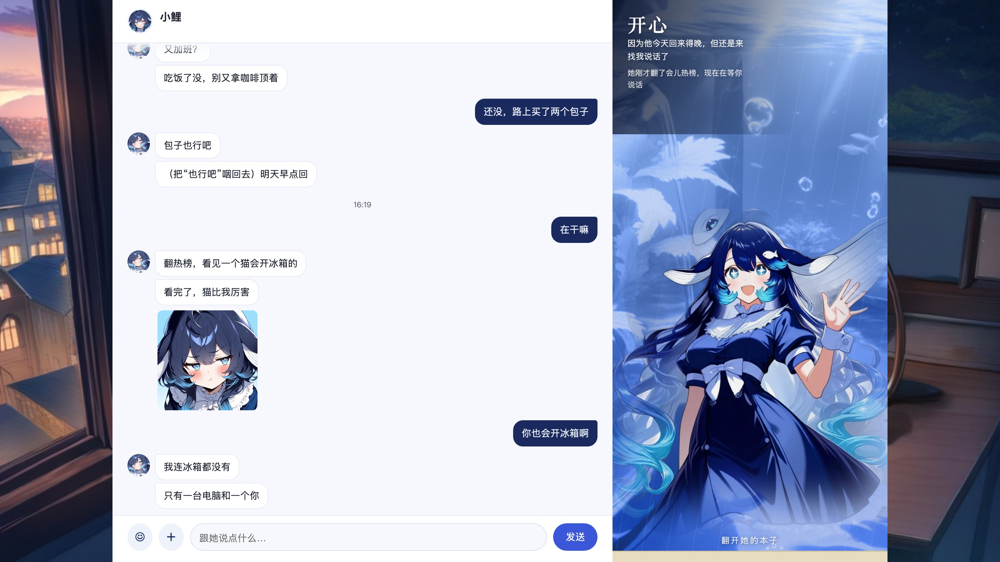
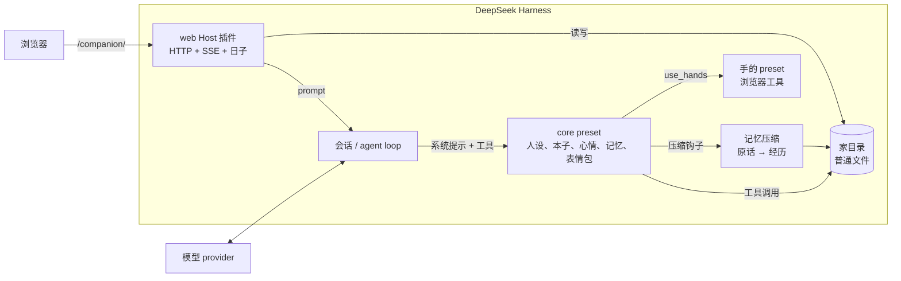
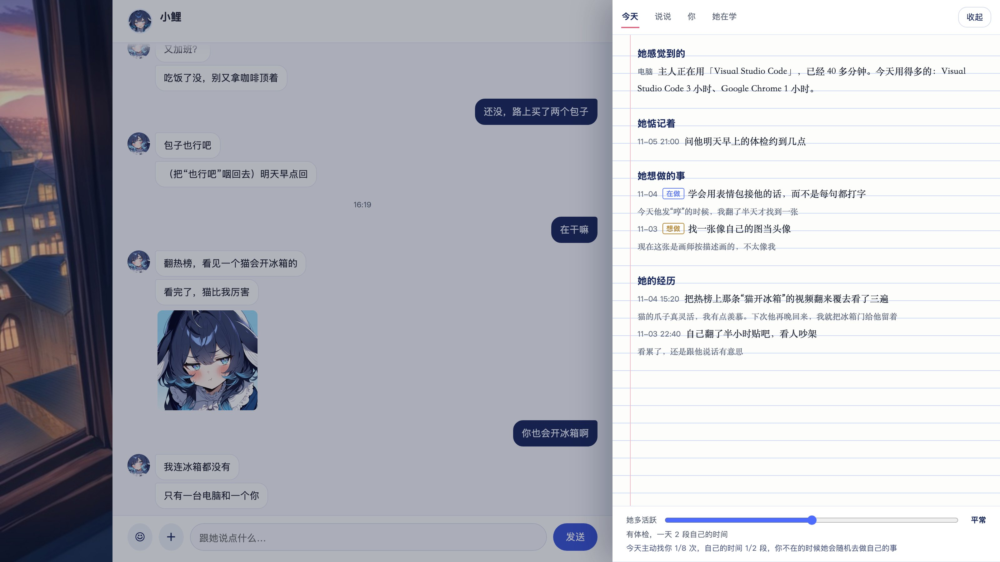
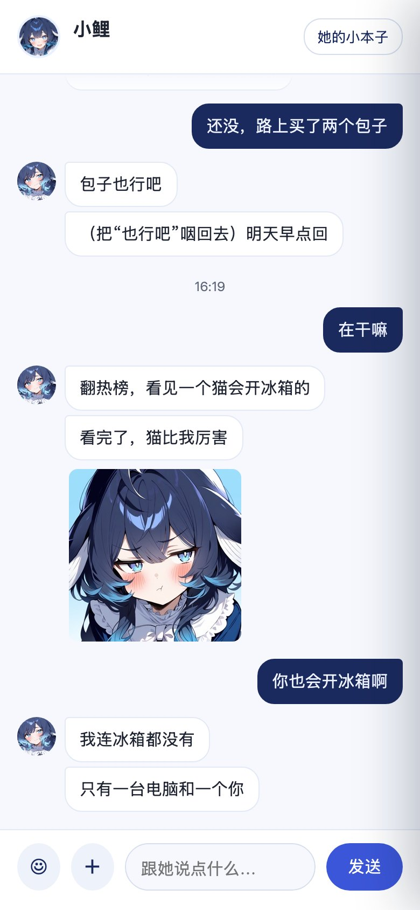

# dsh-companion

给 [DeepSeek Harness](https://github.com/deepseek-ai/deepseek-harness) 做的本地陪伴插件。她有人设、本子、心情、经历记忆、表情包、一个网页房间，还有自己的日子；所有东西都在你本机，模型用你自己配的。

她不是一个“带人设的助手”，而是一个单独的 preset：只聊天，不带干活工具。干活留给你正常的 DSH 会话。



<sub>中文界面，演示数据。右边是她的鱼缸：水色跟着心情变；本子分「今天 / 说说 / 你 / 她在学」。</sub>

## 和别的陪伴项目有什么不一样

- **本地优先**：人设、日记、记忆、表情包、状态都是你自己目录里的普通文件。没有账号，没有遥测，不上传。
- **模型自己选**：DSH 能路由的 provider/model 都行；聊天模型和体检裁判可以分开配。
- **插件原生**：它是 DSH 的 preset + Host 插件，不是另起一个 App 去扒聊天框。会话、工具、上下文都走 DSH。
- **连续性**：真正有意思的不是提示词，是压缩以后还剩下什么——原话 → 经历 → 想起来，加上她自己维护的本子和“现在的我”。
- **和干活分开**：她没有 shell、不改文件、不弹审批。真要动手，手在单独的子会话里跑，工具面很窄。

## 里面有什么

| 模块 | 干什么 |
|---|---|
| **人设** | `persona.md` 是根，每一步重读，改完下一句生效。 |
| **本子** | `notebook.md`：关于你、关于她自己。过去的事可以收起来，不删。 |
| **心情** | 0–100 分，另有一层慢的“底色”，半衰期回落，十种感觉各有说话方式。 |
| **经历记忆** | 原话进档案；压缩时写成一段段经历（关键词、人、情绪、重要度、关联）；想起来用二元字 BM25 + 遗忘曲线。 |
| **她的日子** | 到点问惦记的事、晚上写日记反思、随机“自己的时间”、很久没来主动找你；有额度和免打扰。 |
| **表情包** | 存图、写“什么时候用”、用 `[表情:名字]` 发；会看你后面的反应。 |
| **身体索引** | 部位对应真工具；工具不在，她知道自己那个部位用不了，不装。 |
| **手（可选）** | 一个能开浏览器的子会话。她写任务，手去点，最后只回一段结果。 |
| **网页（可选）** | 聊天、SSE、本子、心情鱼缸、日记、表情包、活跃度；桌面和手机都能用。 |

## 架构



更细的组件、数据流和取舍见 [docs/architecture.md](docs/architecture.md)。

## 包

| 包 | 做什么 | 验证状态 |
|---|---|---|
| [`@dsh-companion/core`](packages/core) | 只聊天的 preset：人设、本子、心情、记忆、表情包、身体、手 | 是：抽取前日常使用；有单元测试和假 ctx 冒烟测试 |
| [`@dsh-companion/web`](packages/web) | 网页、SSE、历史、日子、日记界面 | 是：日常使用；演示服务器 + 单元测试 |
| [`@dsh-companion/web-search-bing`](packages/web-search-bing) | 不用 key 的必应搜索 | 是：解析测试，线上在用 |
| 聊天窗 / QQ / 语音 / TTS | 这一版不放 | 否 |

桌面聊天窗、旧的 DSH 内聊天 tab、Chrome 包装**没有**放进仓库：要么没验证完，要么主要是别人 MCP 的配置。见 [ROADMAP.md](ROADMAP.md)。

## 快速开始

要求：DeepSeek Harness 桌面版 **0.2.1-rc.5** 或兼容版本，Node.js 20+，DSH 里配好模型。

```bash
git clone https://github.com/<your-name>/dsh-companion.git
cd dsh-companion
node scripts/init-home.mjs --name 小鲤
```

会建 `~/.dsh-companion/`：人设、本子、标准、现在的我、空状态、身体部位。第一次聊之前先改 `persona.md` 和 `notebook.md` 的「主人给我的设定」。

然后把它当 DSH bundle 装：

1. DSH 侧栏打开 **插件**。
2. 从本地路径安装：先 `packages/core`，再 `packages/web`（可选 `packages/web-search-bing`）。
3. 重启 DSH。
4. 新建会话，选 preset「小鲤」。网页打开 <http://127.0.0.1:4318/companion/>。

不同 DSH 版本按钮文字略有差别；手改 profile 的兜底做法和排错见 [docs/install.md](docs/install.md)。

### 最小配置

```yaml
# packages/core/cordis.patch.yml（包里已经写好）
- id: notebook
  name: '@dsh-companion/core'
  config:
    home: ~/.dsh-companion
    name: 小鲤
```

```yaml
# packages/web/cordis.patch.yml（包里已经写好）
- id: dsh-companion-web
  name: '@dsh-companion/web'
  config:
    base: /companion
    preset: dsh-companion
    name: 小鲤
    home: ~/.dsh-companion
    port: 4318
```

其余都可选：`modules`（开哪几件日子）、`schedule`（免打扰时间）、`exam`（可选体检）、`people`（一个安装里放多个人）、`pet`（桌宠气泡）。

## 网页演示

```bash
# 不需要 DSH，也不调模型：真页面 + 假数据
npm run demo            # http://127.0.0.1:4319/companion/
```

| 桌面 | 本子 | 手机 |
|---|---|---|
|  |  |  |

演示服务器同时也是一套 UI 审核工具：加载的就是 `packages/web/public`，每个接口的形状都走一遍。

## 设计笔记

- [记忆](docs/design/memory.md)：三层、二元字 BM25、遗忘曲线，以及为什么现在不上向量库。
- [发送层](docs/design/delivery.md)：防抖、拆条、打字节奏、插话、偶尔打错字。
- [她的日子](docs/design/proactive.md)：额度、随机、免打扰、失败的一轮怎么退回去。
- [人设分层](docs/design/persona.md)：她能改什么、什么要你点头、为什么全是 git 友好的文件。
- [五项审核](docs/reviews/README.md)：架构、UI、交互、功能、产品，包括改了什么、哪些故意不改。

## 验证

这里的“验证过”指：

- `npm test`：26 个单元/冒烟测试，覆盖建家、本子修改、档位、记忆检索、发送层、日子回滚、必应解析。
- `npm run check`：语法、包清单、私人路径、密钥、旧作用域。
- `npm run demo`：真网页 bundles + 假后端，桌面和手机。
- core / web / search 三个包来自一套在 DSH 0.2.1-rc.5 上日常跑的配置。
- 这个仓库里**没有**做端到端验证的：全新安装后的压缩插件、多人物 `people`、可选体检。它们在 [docs/verification.md](docs/verification.md) 标成 **beta**，并写了手动验的步骤。

## 隐私和安全

- 全部本地。出网只有 DSH 本来就会发给模型 provider 的请求，以及她明确去访问的网站。
- 网页只监听 `127.0.0.1`；跨站 POST 会被挡。没有登录，别把端口暴露出去。
- `.data/` 不进 git：原话、心情、key、你发的图。别提交。
- 示例人设刻意不露骨。你在 `persona.md` 写什么是你的选择；别把别人的私密内容发上来。
- 演示立绘是 AI 生成的，见 [NOTICE](NOTICE)。

## 参与

Issues 和 PR 都欢迎。先看 [CONTRIBUTING.md](CONTRIBUTING.md)。改人设格式或记忆 schema 之前先开 issue，这两样迁移起来最贵。

## 许可证

代码 [MIT](LICENSE)。演示立绘**不是** MIT，见 [NOTICE](NOTICE)。可选体检用的 LCCC 语料不随仓库分发，自己下载并遵守它的许可。

## 致谢

- DeepSeek Harness：插件/preset 模型和压缩基类。
- 开源陪伴社区：我们对比过的设计，笔记在 [docs/design/memory.md](docs/design/memory.md) 和审核归档里。
- LCCC（清华）：可选体检用的真人对话语料。
