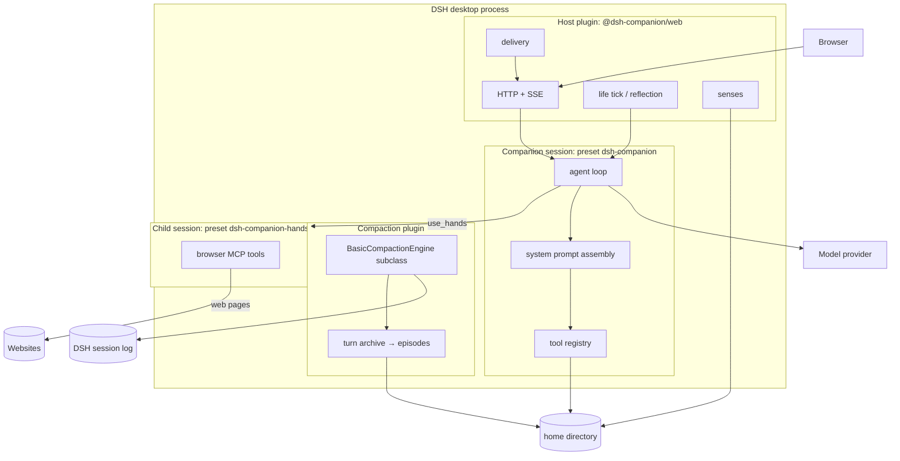
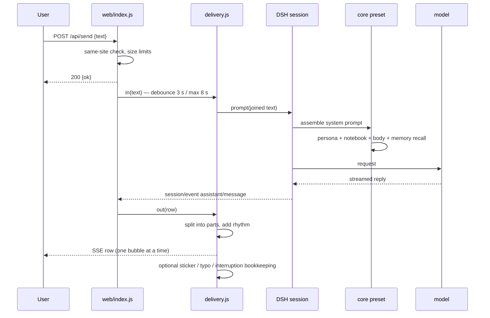

# Architecture

This document describes what runs where, why the packages are split the way they are, and which parts are deliberately boring.

## 1. Goals and non-goals

**Goals**

- A companion that survives context compaction: she still remembers the relationship, not just the last 20 messages.
- Local-first: all long-lived state is plain files in one directory; no database, no service, no account.
- A clean separation between *talking* and *working*. The companion has no shell, file editing, or approval tools.
- Installable as normal DSH bundles, with a web room that can be added or removed without touching the brain.
- Small enough to audit: ~4k lines of JavaScript, no build step for the server packages.

**Non-goals (for this release)**

- Multi-user hosting, accounts, or a cloud sync service.
- Fine-tuning, embeddings, or a vector database. The retrieval layer is deliberately lexical until the corpus justifies more.
- A general role-play frontend. This is a specific companion with a specific data model.
- Voice, Live2D/3D, QQ/OneBot. They are on the roadmap, not in the verified release.

## 2. Runtime topology



The companion session is created by the web plugin (`sessionController.create({ agentPreset })`) or by the user picking the preset in DSH. It is a normal DSH session; the web plugin only sends prompts and listens to session events.

## 3. Package boundaries

```
packages/
  core/                 @dsh-companion/core
    index.js            preset entry: prompt, notebook, tools, memory, body
    mind.js             mood, reminders, diary, lessons, self/owner, stickers
    level.js            activity levels 0–4
    surf.js             hot lists, comments, slang
    social.js           douyin/tieba feeds with daily budgets
    pics.js             image search → stickers
    stickers.js         sticker library and selection
    body.js             body/skills/memory indexes, recall
    hands.js            use_hands + the hands preset prompt
    memory/             turn archive, episodes, recall, compaction
    config.js           home resolution and first-run seeding
    templates/          the example home
  web/                  @dsh-companion/web
    index.js            HTTP routes, SSE, session wiring, people
    delivery.js         debounce, split, rhythm, interruption
    life.js             reminders, own time, nudges, reflection schedule
    senses.js           what app the user is in, idle/locked
    exam.js             optional Turing-style judge
    public/             the real UI (no framework, no build)
  web-search-bing/      @dsh-companion/web-search-bing
```

Dependency rules:

- `web` depends on `core` through **package exports** (`@dsh-companion/core/mind`, `/level`, `/body`, `/stickers`, `/config`), never through `../core/file.js`.
- `core` never imports `web`. It does not know a web room exists.
- `web-search-bing` is independent; it only registers a `ctx.web` provider.
- Shared **data** is the home directory, not an in-process singleton. Two packages may read the same file; writes go through `writeFileAtomic`.
- The only intentional in-process coupling is the in-memory memory store (`openMemory` caches one instance per home), because the chat side and the compaction side must see the same turns during a session.

Why a monorepo and not five packages: the three packages are versioned together, share a release note and a test run, and are installed from one checkout. Splitting `mind.js`/`memory` into separate npm packages would add ceremony without a real boundary; they are a modular monolith with explicit exports. The web room is a separate package because users may want the brain without the web UI (and vice versa is not useful).

## 4. A message, end to end



Key details:

- The user's own bubble is echoed immediately by `/api/send`; the SSE stream only carries her rows. This avoids double rendering.
- `delivery.in` debounces so three short messages become one prompt. If the user speaks while she is still sending, the unsent tail is recorded in `.data/unsent.json` and she is told which lines were not seen.
- History reconstruction (`/api/history`) re-splits stored assistant messages, so a refresh shows the same bubbles as the live stream.
- The web plugin stores only the session id in `.data/web-session.json`; the transcript belongs to DSH.

## 5. Home directory

```
~/.dsh-companion/
  persona.md            root identity; only the owner (or an approved proposal) changes it
  notebook.md           owner facts + her own notes + past items
  standard.md           who she wants to be
  self.md               the current her, edited by grow
  owner.md              what she knows about the owner, organized by sections
  experiences.md        one line per thing she did
  moments.md            short posts
  reminders.json        things to ask about
  lessons.json          learned behaviors with good/bad counts
  wants.json            things she wants to do
  slang.json            learned internet expressions
  proposals.json        proposed changes to persona.md
  stickers/             images + aliases.json + meta.json
  body/<part>/PART.md   body parts and their required tools
  body/wishlist.md      things she cannot do yet
  skills/<name>.md      procedures learned by the hands
  diary/YYYY-MM-DD.md   evening diary
  exams.md              optional exam history
  .data/                runtime state (git-ignored)
    memory/turns.jsonl
    memory/episodes.jsonl
    memory/recalls.jsonl
    memory/checkpoints.jsonl
    mind/mood.json, life.json, now.json
    web-session.json
    stickers-in/
```

Everything except `.data/` is human-editable Markdown/JSON and is meant to be committed by the owner. The core plugin will `git add/commit` changes if the home is a git repository, using the companion's name as the author. That is why `persona.md` requires owner approval: it is the stable root, and its history matters.

## 6. Memory

Three layers, one write path:

1. **Short-term** — the DSH session history. Compaction is triggered at `thresholdTokens` (default 24k) and keeps `retainTokens` (default 6k).
2. **Episodic** — every user/assistant turn is archived to `turns.jsonl` as it happens. On compaction, the shadowed turns are grouped into bouts (30-minute gap, day boundary at 04:00, max 40 turns), and a model call turns each bout into an episode. If the model fails, a rule-based rough episode is written so compaction never fails.
3. **Long-term** — notebook, owner model, self model, standard, lessons. These are in the system prompt every turn, so they must stay small.

Recall runs before each model step: the user's current message is the cue; episodes are scored with BM25 over character bigrams, multiplied by a forgetting curve and importance; the top 3 (plus one linked episode) are inserted into the prompt. Recalled episodes get `recalled + 1`, which slows forgetting.

The design rationale, formulas, and comparison with Mem0/Letta/Graphiti/Generative Agents are in [design/memory.md](design/memory.md).

## 7. Proactive life

A single 60-second tick in `life.js` checks four optional modules:

| Module | Trigger | Budget |
|---|---|---|
| `remind` | a reminder's time has passed | level's daily nudge budget |
| `reflect` | after `schedule.reflectAt` and the user talked today | once/day |
| `own` | random roll after 20 min of quiet | level's own-time budget |
| `nudge` | user idle for an exponentially growing interval | level's daily budget, gives up after 3 unanswered |

All four send a `（旁白）` prompt. The web layer hides narration from the transcript; if she replies `[沉默]`, nothing is delivered. If the turn fails (provider error, timeout), `onTurnEnd` rolls the counters back and re-arms the reminder, so a network outage does not consume her budget.

## 8. Configuration and first run

`config.home` is the only required path. `~` is expanded, relative paths resolve against the DSH process's working directory, and if nothing is given the default is `~/.dsh-companion`.

`ensureHome()` is idempotent: it creates missing files from `templates/` but never overwrites existing content. That makes the first run work without a setup wizard and makes upgrades safe.

The preset patch in `packages/core/cordis.patch.yml` declares two presets:

- `dsh-companion` — the companion.
- `dsh-companion-hands` — the child session used by `use_hands`.

The web patch is a separate host row. Disabling it leaves the brain fully functional.

## 9. Security model

- The web server binds to `127.0.0.1`; the fixed port is a convenience, not a public service.
- State-changing requests are rejected when `Sec-Fetch-Site` is `cross-site` or `same-site`. `curl` (no header) still works for local scripting.
- Static responses carry CSP, `nosniff`, `no-referrer`, `DENY` framing. Images are restricted to self/data.
- Uploads are limited to 4 MB and png/jpeg/webp/gif; the body limit is 7 MB; text is limited to 4000 characters.
- Sticker names are resolved through the sticker index, not joined into a path. Incoming image ids are validated against `s-<10 hex>`.
- The companion has no shell/file tools. `use_hands` runs a child session with the browser MCP only; the prompt tells it not to spend money, delete things, change passwords, or send private messages unless the task says so.
- `.data/config.json` (provider keys) is never read or logged by these plugins.

Residual risks: a local process can read the home directory; the browser MCP has whatever logins the user's Chrome profile has; the web UI has no login. These are documented, not solved, because the threat model is a single-user laptop.

## 10. Failure modes

| Failure | Behavior |
|---|---|
| Model/provider down | Turn ends with an error; life rolls back the nudge/reminder; the UI shows the reason. |
| Port 4318 busy | Logs a warning; the DSH-port route still works. |
| dsh-pet absent | `pet` unset by default; no broadcast attempts. |
| Chrome MCP absent | `use_hands` reports that the hands are not connected; she can record a wish. |
| DSH host packages moved | `hostdeps.js` tries `DSH_HOST_MODULES`, `argv[2]`, and Electron's `resourcesPath`; compaction fails loudly if none match. |
| Corrupt JSON state | Readers fall back to defaults; atomic writes prevent partial files. |
| Home missing | `ensureHome` seeds it. |
| Persona empty | The plugin throws a clear error instead of running without an identity. |

## 11. Decisions

| # | Decision | Why |
|---|---|---|
| ADR-1 | Monorepo, three packages | One test run, one release note, one checkout; the boundary that matters is brain vs. web. |
| ADR-2 | Modular monolith for the brain | `mind`, `memory`, `body`, and tools share one home and one prompt; separate packages would add version skew without isolation. |
| ADR-3 | Plain files, no database | User ownership, git history, and offline editing matter more than query speed at this scale. |
| ADR-4 | Lexical recall before embeddings | The corpus is small; BM25 over bigrams is explainable and free. Revisit at ~500 episodes or when paraphrase recall fails. |
| ADR-5 | Compaction is a DSH subclass | Reuse DSH's transaction/lock/overflow handling; only replace the summary. |
| ADR-6 | Exam is opt-in | It needs a separate judge model and a corpus with its own license; a fresh install should not fail because of it. |
| ADR-7 | Window/QQ/voice excluded from v0.1 | They were not verified end-to-end; shipping them would make the "verified" claim false. |
| ADR-8 | Example persona is original and non-explicit | The real deployment's persona is private; the repo must be safe to clone and screenshot. |

## 12. Known risks

- **DSH internal API churn.** The compaction subclass imports host packages; a DSH upgrade can break it. Pinned compatibility is documented, and the failure is loud.
- **Prompt/context cost.** Long-term files are always in the prompt. The notebook has a 12k-character cap with oldest-first dropping, but owners can still make it expensive.
- **Emotional dependency.** The product is designed to be warm; the docs should be explicit that it is a character, not a substitute for people. The persona prompt says not to pretend to be human when asked.
- **Single maintainer.** The release includes tests and a demo server specifically so contributions do not require the author's live setup.
