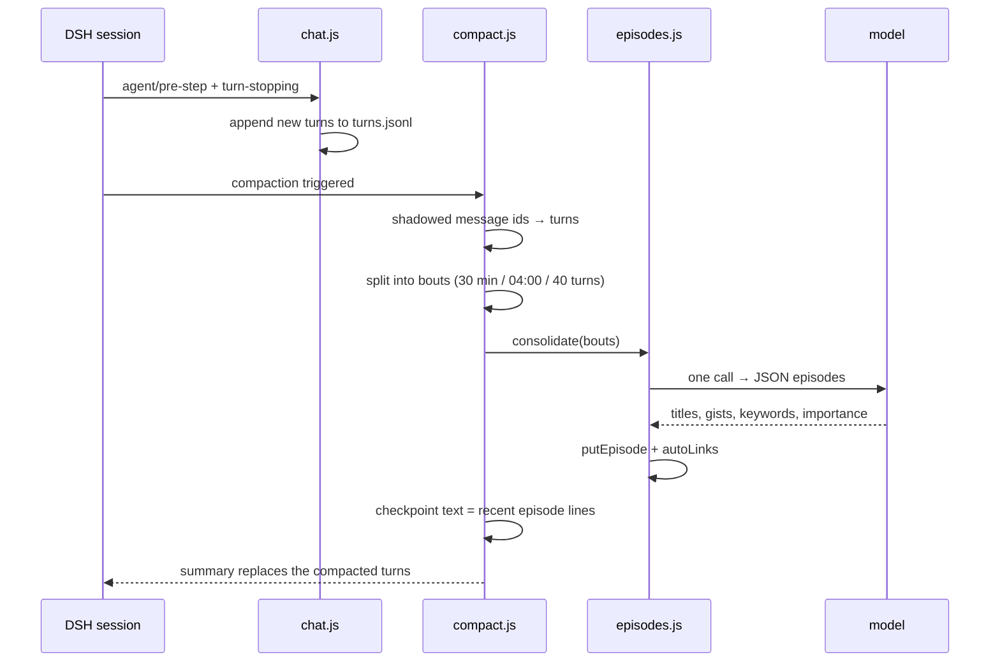

# Memory design

The goal is not "store everything". It is: **after 50k tokens of chat, does she still know what matters, and can she bring it up at the right moment without leaking the whole transcript into every request?**

## Three layers

| Layer | Content | Where | Written by | Forgetting |
|---|---|---|---|---|
| Short-term | The live DSH session | DSH session log | DSH | Compacted at 24k tokens, 6k retained |
| Episodic | Episodes: one bout of conversation, summarized | `.data/memory/episodes.jsonl` | Compaction hook | Yes — exponential decay |
| Long-term | Notebook, owner model, self model, standard, lessons | Markdown/JSON in the home | Her tools + evening reflection | No; always in the prompt |
| Archive | Raw turns | `.data/memory/turns.jsonl` | Chat hook, append-only | Never deleted |

The archive is what makes the middle layer auditable: every episode points at `turnIds`, so `look_back` can re-read the original words.

## Why not a vector database (yet)

The usual stack is: embed every message, store in a vector DB, retrieve top-k. That is attractive, but at this scale it has three problems:

1. **No embedding model in the target environment.** The reference deployment's gateway only served chat models. Shipping a local `bge-small` adds ~100 MB and a Python/ONNX dependency.
2. **Explainability.** When she brings up the wrong memory, BM25 lets us see which tokens matched. Cosine similarity does not.
3. **Chinese without spaces.** A character-bigram index is cheap and works surprisingly well for short, informal messages.

Comparison with the systems we studied:

| System | Unit | Retrieval | What we borrowed / rejected |
|---|---|---|---|
| Mem0 | Fact/preference memory | Vector + graph | Borrowed: memory as extracted facts, not raw turns. Rejected: extra LLM call per turn and a vector store. |
| Letta (MemGPT) | Self-edited memory blocks | Agent tool calls | Borrowed: the agent can edit its own long-term state. Rejected: the full paging machinery; DSH already has compaction. |
| Graphiti | Temporal knowledge graph | Graph queries | Borrowed: episodes have time and links. Rejected: graph DB and entity resolution. |
| Generative Agents | Observation → reflection → plan | Recency/importance/relevance | Borrowed: the three-factor score and periodic reflection. |
| MemoryBank | Ebbinghaus-style decay | Similarity × strength | Borrowed: the forgetting curve and recall-strengthening. |
| A-MEM / MemoryOS / Nemori | Linked notes / hierarchical memory | Various | Borrowed: links and "importance" fields. Rejected: their storage stacks. |

Our position: **lexical retrieval + a forgetting curve + an explicit long-term layer** is the 80% solution at 1/10 the operational cost. Revisit when either (a) episodes exceed ~500 and recall quality drops, or (b) users report "she doesn't get it when I paraphrase".

## Episode schema

```json
{
  "id": "e7",
  "from": 1793370000000,
  "to": 1793373600000,
  "day": "2026-11-02",
  "turnIds": ["t40", "t41"],
  "title": "展馆排队",
  "gist": "他说去展览排了一小时队，只玩了一分钟，还说不吓人。",
  "keywords": ["展馆", "排队", "展览"],
  "people": [],
  "his_mood": "松",
  "her_mood": "开心",
  "emotion": 1,
  "importance": 2,
  "open": ["他说下次带我去"],
  "links": [{ "id": "e3", "why": "他上次说去展览" }],
  "recalled": 0,
  "lastRecalled": 1793373600000
}
```

`importance` is 1–5, `emotion` is 0–2. Both are produced by the extraction prompt and clamped. The rough fallback sets `rough: true` and a short rule-based gist, so a failed model call never blocks compaction.

## Scoring

```
strength S = 2 + 1.5 × importance + 2 × emotion + 2 × recalled   (days)
             + 60 if importance == 5
retention  = exp(-days_since_last_recall / S)
score      = relevance + 0.5 × retention + 0.3 × importance / 5
```

- Relevance is BM25 normalized by the top score, so the best match is 1.0.
- Automatic recall drops anything below `minRelevance = 0.3` and `forgetBelow = 0.05`.
- Each recall adds 2 days of strength (via `recalled`), capped by the 10-minute de-duplication.
- One linked episode may be added (`follow = 1`) to bring cause/effect along.

The constants are deliberately conservative. It is better for her to say "I don't remember" than to confidently surface a stale memory.

## Write path



The checkpoint text is what remains in the live history. It lists only episodes from the last 3 days (max 12), plus a header telling her not to mention "records" or "summaries". Older episodes are reachable only through recall.

## Read path

Before each model step, `chat.js`:

1. Takes the user's current message as the cue (it is not in the session yet at `agent/pre-step`).
2. Skips very short messages, pure acknowledgements, and goodbye messages (`BYE_RE`).
3. Excludes episodes already represented in the live history and episodes listed by a checkpoint.
4. Searches, takes up to 3, plus 1 linked episode.
5. Marks them recalled and injects a compact block into the per-turn context.

The block is intentionally short: one line per episode, with the date and the open loops. It is not a transcript.

## Long-term layer

Long-term memory is not retrieved; it is always present. That is a deliberate trade: it costs tokens but guarantees continuity of the relationship. The files are kept small by design:

- `notebook.md`: hard cap 12k characters. When it overflows, the oldest dated bullets are dropped, except the owner's setup section.
- `owner.md`: organized by sections; the evening reflection rewrites "his recent mood" and "our words".
- `self.md`: she may edit one section at a time with `grow`.
- `standard.md`: her aspirational standard; used as reflection material, not as a rulebook.
- `lessons.json`: at most ~15 active behaviors; trial → kept/dropped based on the owner's reactions.

## Evening reflection

If enabled, the `reflect` module runs once after 22:30 on a day the owner talked. It:

1. Optionally runs the exam (a separate judge model guesses which lines are AI).
2. Collects today's reactions (reply delay, length, app), today's episodes, trial lessons, and her standard.
3. Sends one narration prompt asking her to write the diary, learn lessons, judge trials, grow, set wants, and update the owner model.
4. Deletes the temporary material file at turn end so the next day's chat does not carry it.

This is the only place where the long-term layer is actively rewritten, which keeps the prompt stable during the day (good for KV cache).

## Evaluation

Current automated coverage: tokenization, bout splitting, day boundary, search ranking, recall strengthening, and the rough-fallback path in code review. Not covered: extraction quality, paraphrase recall, and long-horizon forgetting.

Manual checks after installation (also in [verification.md](../verification.md)):

- Talk for a day, force a compaction, confirm `episodes.jsonl` gains episodes with `rough` absent.
- Say something that should trigger an old episode; confirm the prompt contains a `[经历]` line and `recalls.jsonl` grows.
- Ask "你那天怎么说的"; confirm `look_back` returns raw turns, not a summary.
- Delete a memory file in a copy and confirm the plugin starts with defaults rather than crashing.

## Open questions

- Should `updates` let a new episode supersede an old contradictory one? (Planned.)
- Should reflection read today's episodes instead of raw reactions? (Planned.)
- Is one linked hop enough, or do we need two with a discount? (Measure first.)
- When do we add embeddings? Trigger: >500 episodes or repeated paraphrase misses.
