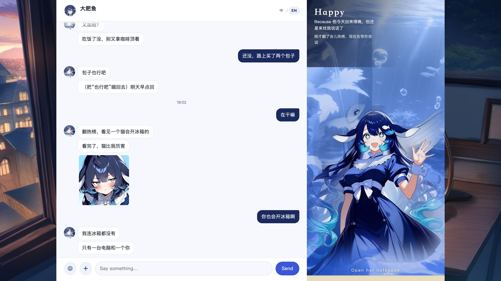
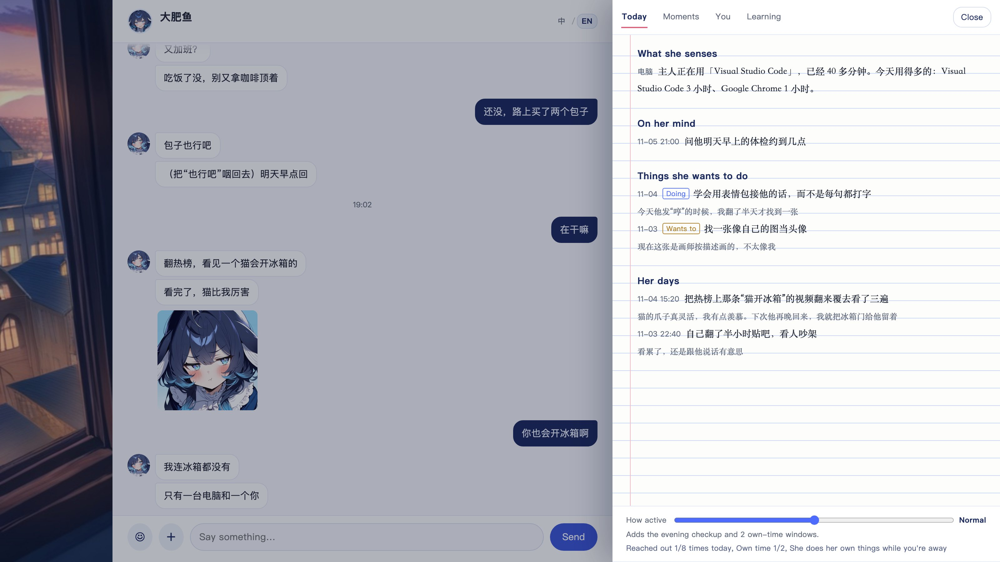
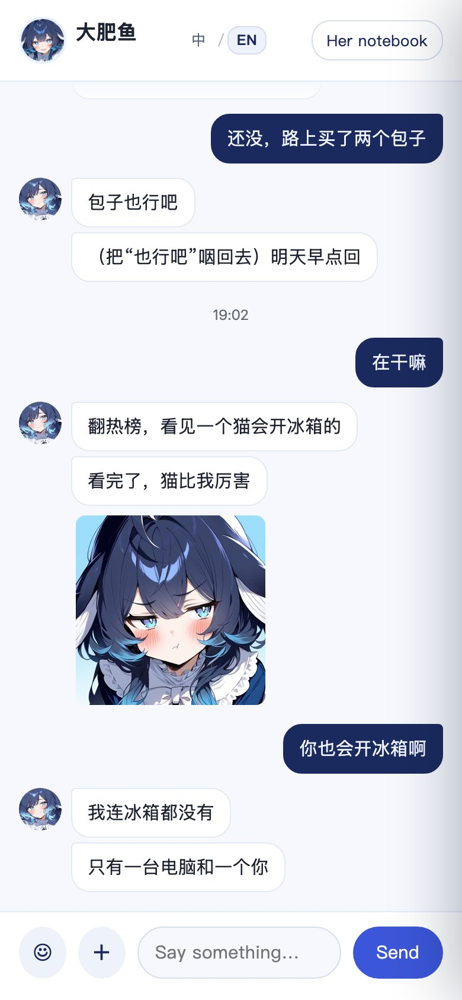
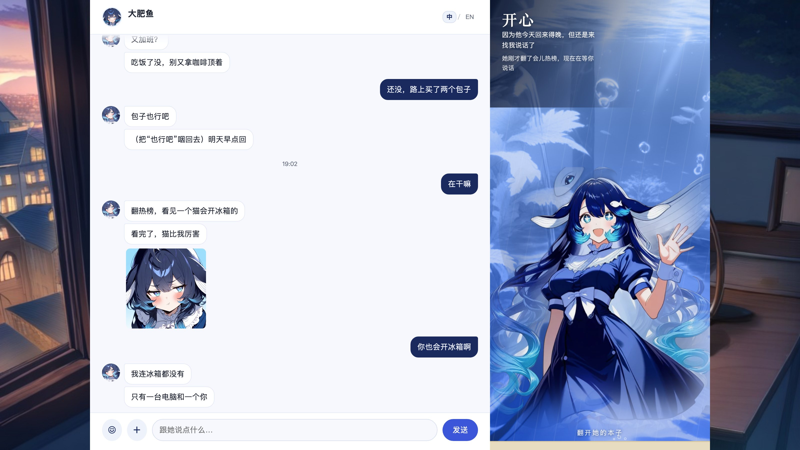

# UI review

**Score: 90 / 100** (before: 70) — pass.

## Scope

The web room at `/companion/`: layout, visual language, typography, responsive behavior at 390 px, accessibility (keyboard, semantics, focus, motion, images), empty/error states, and the demo screenshots. Not reviewed: copywriting (product), model output quality, the desktop pet's own UI.

## Visual direction

The interface is built around a single metaphor: a desk with a small tank on it.

- **Palette** is taken from the character: whale blue `#4d6bfe`, deep water `#1b2a5e`, blush `#e0607e`, paper `#fdfdfb`.
- **Left** is a conventional chat: white bubbles, a deep-blue user bubble, a fixed composer.
- **Right** is not a sidebar of widgets; it is the tank. The water gradient and the figure's saturation/brightness are driven by one CSS variable (`--mood`), so the whole panel reads as one object.
- **The notebook** is a paper surface with ruled lines and a red margin, opened as a drawer. It deliberately looks like a different material from the chat.
- **Type**: system sans for the chat, Songti for the mood word and the notebook, so the notebook feels written rather than rendered.

This is a coherent direction, not a component-library default. The main risk is that it is *specific*: a different character will need new art and a new palette, but the layout still works.

## Checklist

| Item | Result |
|---|---|
| Visual hierarchy: name/status → chat → composer | Pass |
| Mood is not conveyed by colour alone | Pass — the mood word and reason are text |
| Desktop 1240 px max width | Pass |
| Mobile 390 px: no horizontal scroll | Pass — `scrollWidth === 390` |
| Mobile drawer covers the page and is dismissible | Pass — overlay click + Esc + 收起 |
| Composer fits on mobile | Pass — placeholder shortened, textarea flexes |
| Keyboard: send, newline, IME | Pass — Enter sends, Shift+Enter newline, `isComposing` respected |
| Keyboard: image picker | Fixed — real button, not a label around a hidden input |
| Keyboard: tabs | Fixed — `role=tab`, `aria-selected`, arrow/Home/End |
| Keyboard: drawer focus | Fixed — focus moves in, Tab trapped on narrow screens, focus returned |
| Screen reader: closed drawer | Fixed — `inert` |
| Screen reader: live chat | `aria-live=polite`; history replay caveat below |
| Error announcements | Fixed — `role=alert` |
| Images: alt text | Pass for stickers; generic "图片" for uploads (S4) |
| Images: open full size | Fixed — each image links to the original |
| Reduced motion | Pass — breathing/bubbles/tank/drawer disabled |
| Focus visibility | Pass — `:focus-visible` ring on all controls |
| Contrast | Pass — Lighthouse accessibility 100 (desktop snapshot) |
| Empty states | Pass — sections hide and collapse into "还空着：…" |
| Language switch | Pass — header 中/EN toggle, remembered, `?lang=en`/`?lang=zh`; English layout checked at 390 px |
| English layout | Pass — no overflow, tabs and composer fit; content (her words/diary) stays in its original language |
| Loading state | Pass — "对方正在输入" + tank breathing speeds up |
| Offline/reconnect | Pass — SSE error status, history reload |

## Findings

| ID | Sev | Finding | Evidence | Status |
|---|---|---|---|---|
| UI-01 | S2 | Image picker was a `<label>` wrapping a `hidden` input: not keyboard-focusable, duplicate a11y nodes | `index.html` | **Fixed**: real `<button>` + `sr-only` input |
| UI-02 | S2 | Closed drawer stayed in the accessibility tree and was tabbable | `.drawer` translated off-screen | **Fixed**: `inert` toggled with the drawer |
| UI-03 | S2 | Tabs had `role=tablist` but no `tab`/`tabpanel`/`aria-selected`/keyboard | `index.html` | **Fixed**: full tab pattern |
| UI-04 | S2 | Focus was not returned after closing the drawer; no trap on mobile | `setBook` | **Fixed** |
| UI-05 | S3 | Mobile composer placeholder wrapped and clipped | 390 px screenshot | **Fixed**: shorter placeholder + title hint |
| UI-06 | S3 | Error region was a plain div | `#error` | **Fixed**: `role=alert` |
| UI-07 | S3 | Chat images could not be enlarged | sticker bubble | **Fixed**: link to original, new tab |
| UI-08 | S3 | Lazy images lacked dimensions (CLS) | Lighthouse console issue | **Partially fixed**: static images have dimensions; dynamic stickers use CSS max sizes |
| UI-09 | S3 | `aria-live` on the list can announce the whole history on first paint | `#list` | **Accepted**: history loads into a live region; a screen-reader pass is needed before changing it |
| UI-10 | S3 | No dark mode | — | **Deferred**: the tank is already dark; a full dark theme is a design project, not a patch |
| UI-11 | S3 | Lighthouse SEO/agentic audits fail because the demo does not serve `robots.txt` / `llms.txt` | Lighthouse | **Won't fix**: a loopback-only personal app is not a crawlable site; the accessibility and best-practices categories are 100 |
| UI-12 | S4 | User-uploaded images use the alt text "图片" | `myPart`/`bubble` | **Deferred**: the image is decorative in context; could use "他发来的图片" |
| UI-13 | S4 | No unread count in the tab title | — | **Deferred** |
| UI-14 | S4 | The "她多活跃" label is jargon | drawer footer | **Accepted**: it is explained by the description and the tooltip |
| UI-15 | S3 | UI was Chinese-only | all strings | **Fixed**: `i18n.js`, header toggle, persisted choice, English screenshots; 7 tests enforce key parity |

## Screenshots

| English desktop | English notebook | English mobile | Chinese desktop |
|---|---|---|---|
|  |  |  |  |

All screenshots come from `npm run demo` with original demo data, not from a private home. The English images use `?lang=en`; the Chinese ones use `?lang=zh`. The character's own words remain Chinese in both because the demo persona is Chinese.

The desktop window (`packages/window`) was audited separately: Lighthouse reports **Accessibility 100 / Best Practices 100** on the demo page. The audit found a label-wrapped file input and low-contrast secondary text; both were fixed (real button, darker muted colors).

## What changed

- Replaced the image label with a button and a visually-hidden input.
- Added `inert` to the closed drawer and focus return/trap.
- Implemented the full tabs pattern and roving tabindex.
- Added `role=alert`, focus rings, `.sr-only`, reduced-motion coverage for the drawer.
- Made chat images open in a new tab.
- Shortened the composer placeholder and added a keyboard hint.
- Added security headers/CSP that do not require inline scripts (the page is a classic script, not inline).

## Still open

The UI is now bilingual (中文/English) with a header switch; the accessibility audit still reports **100 / 100** in both languages.

A desktop Lighthouse snapshot now reports **Accessibility 100 / Best Practices 100** (SEO and agentic-browsing audits are irrelevant for a loopback-only app and are deliberately not chased). The remaining gap is a screen-reader pass: the manual keyboard checks are real, but VoiceOver/NVDA coverage would make the drawer and tab flows a 1.0 claim.

## Verdict

The visual language is distinctive and the responsive/accessibility issues found in the audit are fixed. Remaining items are polish and formal verification. **Pass.**
